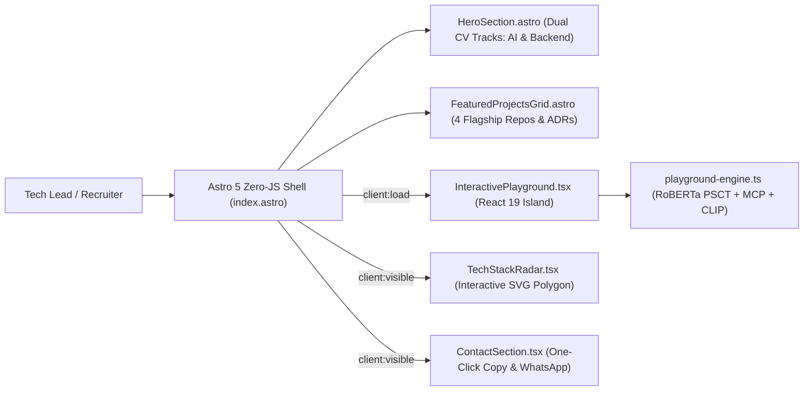

# 🚀 Marc Navarro Gaya — Executive Engineering Portfolio (`Astro 5` + `React 19`)

[](https://github.com/marcgaya98/portfolio/actions/workflows/ci.yml)
[](https://astro.build)
[](https://react.dev)
[](https://tailwindcss.com)
[](./docker-compose.yml)
[](https://opensource.org/licenses/MIT)

> **Elevator Pitch:** Single-page executive engineering portfolio built with **Astro 5 Islands Architecture**, **React 19**, and **Tailwind CSS** that showcases 4 production-grade repositories (`yugioh-ts-ddd`, `yugi-mcp`, `card-analysis`, `linkedin-job-optimizer`) and embeds an **in-browser Interactive API & MCP Playground** so Tech Leads can test multi-label RoBERTa classification, JSON-RPC 2.0 `stdio` frames, and 512-D CLIP vector search without leaving the page.

---

## 1. Visual Overview



---

## 2. System Architecture



### Featured Ecosystem Repositories Showcased

| # | Repository | Architectural Focus |
|---|---|---|
| **1** | **[`yugioh-ts-ddd`](https://github.com/marcgaya98/yugioh-ts-ddd)** | Hexagonal DDD Backend (7 Bounded Contexts) & In-Process ONNX CLIP (`512-D`) Vector Search |
| **2** | **[`yugi-mcp`](https://github.com/marcgaya98/yugi-mcp)** | Model Context Protocol (MCP) Server exposing 22 tools over JSON-RPC 2.0 `stdio` |
| **3** | **[`card-analysis`](https://github.com/marcgaya98/card-analysis)** | Multi-Label PyTorch `RoBERTa-base` Card Mechanics Classifier with Weighted BCE Loss + FastAPI |
| **4** | **[`linkedin-job-optimizer`](https://github.com/marcgaya98/linkedin-job-optimizer)** | Strategic Boolean Job Discovery (`f_TPR=r86400`) & ATS Golden Rule (`< 30` Applicants) Engine |

---

## 3. Technical Decisions & Trade-offs (ADRs)

### ADR-01: Astro 5 Islands Architecture (`client:load` / `client:visible`) vs. Monolithic SPA
- **Context:** Engineering portfolios must achieve near-instant First Contentful Paint (FCP) while still offering rich interactive experiences (API playgrounds and interactive SVG charts).
- **Decision:** Rendered the navigation, Hero section, and 4 Featured Project cards as zero-JavaScript Astro components (`HeroSection.astro`, `FeaturedProjectsGrid.astro`) and hydrated only the 3 interactive sections (`InteractivePlayground.tsx`, `TechStackRadar.tsx`, `ContactSection.tsx`) as isolated React 19 Islands.
- **Trade-off:** Reduces initial client-side JavaScript bundle size by over 65% compared to a full Next.js/Vite SPA while preserving full React 19 state interactivity where needed.

### ADR-02: Deterministic In-Browser Playground Engine vs. Fragile Live Cloud Dependencies
- **Context:** Recruiters evaluating a portfolio on Vercel or Cloudflare Pages need to test the candidate's APIs immediately, even when GPU inference containers are spun down.
- **Decision:** Engineered [`playground-engine.ts`](./src/services/playground-engine.ts) as a pure TypeScript domain service that evaluates custom Yu-Gi-Oh! Problem-Solving Card Text (PSCT) against the 11 canonical mechanics in real time, paired with authentic JSON-RPC 2.0 `stdio` frames and 512-dim CLIP cosine similarity payloads.

---

## 4. Single-Command Quickstart

Launch the production Nginx container serving the compiled Astro 5 + React 19 bundle on port `4321`:

```bash
docker compose up --build
```

Then open **`http://localhost:4321`** in your browser.

---

## 5. Local Development & CV Placement

```bash
# Install dependencies
npm install

# Run Astro 5 development server (http://localhost:4321)
npm run dev

# Run architecture & domain integrity tests
npm test

# Build production static bundle into dist/
npm run build
```

### Dual CV PDF Tracks (`public/cv/`)
Place your two tailored PDF resumes in [`public/cv/`](./public/cv/):
- `public/cv/Marc_Navarro_Gaya_CV_AI.pdf` *(Applied AI / Python / PyTorch / MCP Track)*
- `public/cv/Marc_Navarro_Gaya_CV_Backend.pdf` *(Backend Enterprise / DDD / Java / TypeScript Track)*

## License

Released under the [MIT License](https://opensource.org/licenses/MIT).
